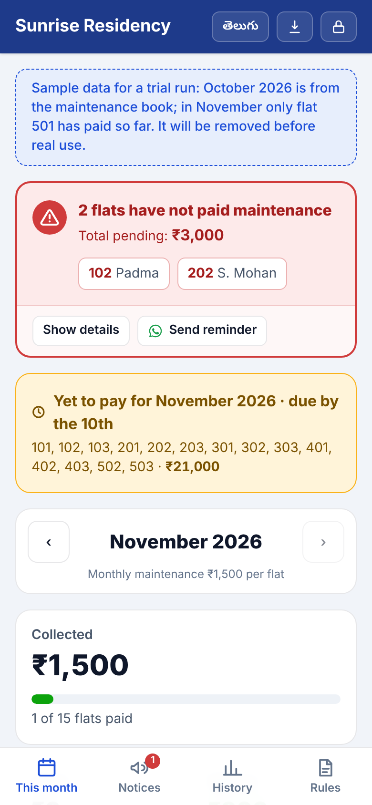
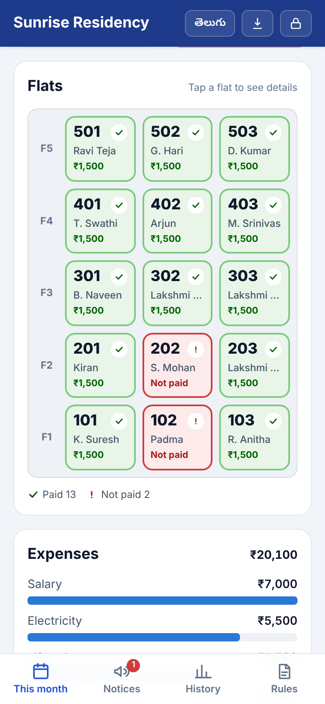
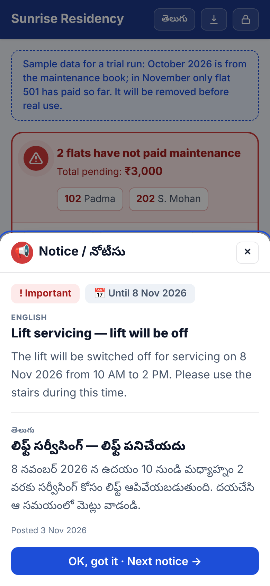
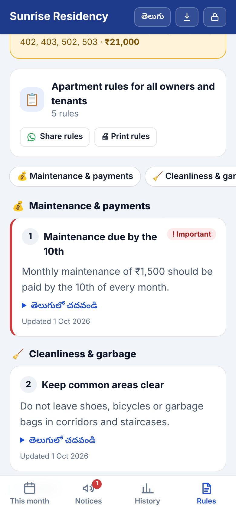
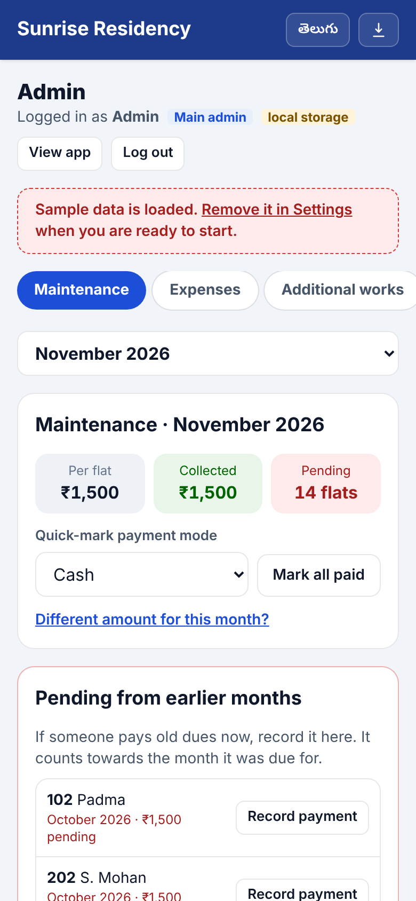

# Apartment Maintenance

A free, mobile-first web app for small apartment associations. It replaces the paper maintenance book: residents see who has paid and where the money went, and admins record payments, expenses and notices from their phones.

Built for a 15-flat building in India, with English and **Telugu** throughout, ₹ amounts, and WhatsApp sharing. Runs free on Vercel with a free Upstash Redis database.

<p align="center">
  
  
  
</p>
<p align="center">
  
  
</p>

## Features

### For residents (no login needed)
- **Red alert** at the top for flats that haven't paid, with months owed and the total pending. Before the due date, this month's unpaid flats show in a softer "yet to pay" list.
- **Flats view**: the building floor by floor, green for paid and red for not paid. Tap a flat to see its full payment history.
- **Monthly summary**: collected, spent, and balance or shortage, with an expense breakdown and a step-by-step "how the balance was worked out" chart. Balances carry over from month to month.
- **Additional works** (pest control, painting…) collected separately per flat, showing costs and who hasn't paid.
- **History**: collected vs spent and month-end balance across months, with a table view.
- **Notices** in English and Telugu. Each one pops up *every time the app is opened until its date*, *once*, or *not at all*. Notices are hidden automatically after their end date. All notices can be printed for the notice board or shared on WhatsApp.
- **Rules**, bilingual and grouped by topic, with an optional one-time pop-up when a rule changes. They can be printed or shared.
- English / Telugu switch, a WhatsApp monthly summary, and a printable monthly statement.
- **Installable** as an app (no automatic install prompt) and works offline with the last loaded data. Light mode only, for readability.

### For admins (`/admin`)
- **Maintenance**: one tap per flat to mark paid, or record amount, date, cash/UPI and a note. Late payments for earlier months can be recorded too.
- **Expenses**: add the regular monthly items in one tap, then add anything else, optionally with a bill photo (visible to residents).
- **Additional works**, **notices**, **rules**, **flats & owners** and **phone numbers** (phone numbers are visible to admins only).
- **WhatsApp sending**: personal reminders to everyone with dues (each with their own amounts), a notice, or a custom message. An owner of several flats gets one message. The free WhatsApp link doesn't allow automatic bulk sending, so the app opens each chat ready to send.
- **Managers**: give someone a limited login to hand over day-to-day work. Managers can run the **current month** only, plus record late payments. They can't change past months, see the edit history, or change settings, rules, owner names or managers. You can pause, remove or reset them, and their login stops working immediately. The server enforces all of this.
- **Book pages** for a paper record, printed on A4 for a 2-hole binder: print each flat's name for residents to sign and write the amount; later put the same sheet back in the printer to print the expenses and balance in the box at the bottom, and mark flats that didn't pay with a red outline and "NOT PAID". Kept separately from the app's figures; **Sync with app** copies names, money, expenses and who has paid at any time. Changes save automatically, a save from an out-of-date copy is refused, and each page keeps a history of who changed which money figure.
- **Edit history** of every change: who did it, and when.
- **Settings**: maintenance amount, due day, opening balance, carry-forward, regular expense list, Excel (CSV) export, and sample data on/off.

## Try it locally

```bash
git clone https://github.com/pavan-98/apartment-maintenance.git
cd apartment-maintenance
npm install
npm run dev            # http://localhost:3000 — admin password in development: "admin"
```

The app starts with **sample data** (made-up names) so you can try everything. Remove it from **Admin → Settings → Remove sample data & start fresh**. Flat owners are kept, and the books start from the current month at ₹0.

Without a database configured, data is saved to `data/db.json`.

## Deploy your own (free)

You need a GitHub account and a Vercel account. Full step-by-step guide: **[docs/VERCEL_SETUP.md](docs/VERCEL_SETUP.md)**. In short:

1. Fork this repository and import it into Vercel.
2. Add environment variables:

   | Variable | Required | What it's for |
   |---|---|---|
   | `ADMIN_PASSWORD` | yes | Main admin password |
   | `AUTH_SECRET` | recommended | Long random text used to sign logins |
   | `NEXT_PUBLIC_APARTMENT_NAME` | recommended | Your apartment's name (title, home-screen app name) |
   | `NEXT_PUBLIC_APARTMENT_SHORT_NAME` | optional | Shorter name under the app icon |

3. In the Vercel project, open **Storage** and connect **Upstash for Redis** (free plan). It adds the database settings automatically.
4. Redeploy, then open `/api/health` to check everything is connected.

## Adapting it to your building

- **Flats**: the building is defined in [`lib/seed.ts`](lib/seed.ts) (`BOOK_FLATS`: flat number, floor and sample owner names). Change it to match your building before the first run. Names can then be edited in the app.
- **Amounts and regular expenses**: set these in Admin → Settings.
- **Language**: all resident-facing text lives in [`lib/i18n.ts`](lib/i18n.ts). To support another language, add a column there.
- **Colours**: change the CSS variables at the top of [`app/globals.css`](app/globals.css).

## How it works

- **Next.js 16** (App Router), **React 19**, **Tailwind CSS 4**, TypeScript.
- All records live in one small JSON document in **Upstash Redis**, or a local file in development. Writes use version checks, so two admins saving at once don't overwrite each other.
- Business logic is plain TypeScript in [`lib/`](lib):
  - `calc.ts`: balances, dues and alerts
  - `actions.ts`: every admin change, validated and logged
  - `permissions.ts`: manager rules
  - `whatsapp.ts`: message building
- Admin logins are signed, HTTP-only cookies. Manager passwords are stored as scrypt hashes and never sent to the browser. Residents never receive phone numbers or the edit history.

```bash
npm test         # unit tests (balances, dues, permissions, notices, messages)
npm run lint     # type check
npm run build    # production build
```

## Contributing

Issues and pull requests are welcome, especially support for more languages, building layouts and payment methods. Please run `npm test` and `npm run lint` before opening a pull request, and keep real residents' names and phone numbers out of code, issues and screenshots.

## License

[MIT](LICENSE) © 2026 Pavan Kalyan Neerukonda
